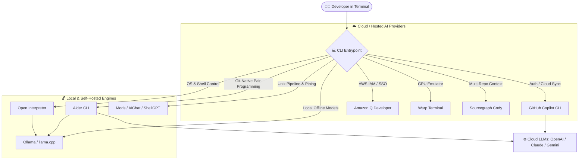

# ⚡ Awesome AI CLI Tools 🤖

**Curated list of terminal AI agents, autonomous coding assistants, and command-line LLM companions** 🚀

  
  
  
  
  
  

> A high-performance, developer-first directory tracking the best **AI CLI tools** 💻, **terminal AI agents** 🕵️, **autonomous coding copilots** 🧑‍💻, and **command-line LLM companions** 🧠. Accelerate shell workflows with automated command generation, AST codebase understanding, local offline inference, and MCP-driven agents.

📅 **Last updated: October 2026**

---

## 📑 Table of Contents

- [🔍 Overview](#-overview)
- [📊 Sector Overview & Market Dynamics](#-sector-overview--market-dynamics)
- [☁️ SaaS & Hosted Platforms](#️-saas--hosted-platforms)
- [🔓 Open-Source GitHub Projects](#-open-source-github-projects)
- [🏗️ Comparison & Architecture Highlights](#️-comparison--architecture-highlights)
- [🤝 How to Contribute](#-how-to-contribute)
- [💖 Support](#-support)
- [⭐ Star History](#-star-history)
- [⚠️ Disclaimer](#️-disclaimer)

---

## 🔍 Overview

Modern software development is experiencing a massive paradigm shift back to the command line 💻. **AI CLI tools** bridge large language models (LLMs) and local shell environments—giving engineers terminal-native agents that can:
- 💡 **Synthesize & explain complex shell commands** (`bash`, `zsh`, `fish`, `PowerShell`).
- 🛠️ **Edit code across multi-file repositories** with full Git integration and diff visualization.
- 🧪 **Run autonomous debug and test loops** directly inside the terminal without context switching.
- 🔌 **Execute local computer-use workflows** and tool-assisted automation via Model Context Protocol (MCP).

---

## 📊 Sector Overview & Market Dynamics

The AI developer tools market—specifically encompassing AI-assisted coding, terminal agents, and autonomous pair-programming tools—is estimated at **$6.5 billion in 2026** and projected to surpass **$24 billion by 2030**, growing at a compound annual growth rate (CAGR) exceeding 30% 📈.

Market dynamics reflect a **moderately fragmented and rapidly consolidating landscape** 🌐: while mega-cap tech conglomerates (Microsoft/GitHub, Amazon, Alphabet) command substantial distribution advantages through IDE and cloud ecosystem bundling, agile specialized startups (Cursor/Anysphere, Warp, Tabnine, Continue) and hyper-popular open-source ecosystems (Ollama, Gemini CLI, OpenHands, Aider) prevent complete winner-take-all capture, driving rapid innovation in local inference, privacy preservation, and multi-model flexibility 🚀.

---

## ☁️ SaaS & Hosted Platforms

The following SaaS platforms provide hosted or cloud-backed AI terminal assistants, sorted in descending order by parent company valuation / enterprise market capitalization 🏢.

| Product / Company | Description | Company Size (Valuation / Market Cap) 💰 | Starting Paid Pricing 🏷️ | Free Tier Limit 🎁 |
| :--- | :--- | :--- | :--- | :--- |
| **[Amazon Q Developer CLI](https://aws.amazon.com/q/developer/)** (Amazon / Fig) | ☁️ Cloud-aware AI terminal coding assistant, code generation, troubleshooting, and AWS shell automation. | **$2.2T** (Market Cap) | **$19/user/month** (Amazon Q Developer Pro) | **Free forever plan**: 50 chat queries/month, 5 code security scans/month, and 1,000 code completion requests/month with AWS Builder ID. |
| **[GitHub Copilot CLI](https://github.com/features/copilot)** (Microsoft / GitHub) | 🐙 Official GitHub Copilot in the terminal for command explanations, shell suggestions (`gh copilot`), and terminal coding. | **$3.1T** (Microsoft parent) / **$7.5B** (GitHub acquisition) | **$10/month** ($100/year for Copilot Individual) | **30-day free trial** with full access to Copilot Individual features; free access for verified students, teachers, and maintainers of popular OSS projects. |
| **[Sourcegraph Cody CLI](https://sourcegraph.com/cody)** | 🔎 Codebase-aware AI assistant leveraging multi-repo semantic search and context retrieval for CLI and IDEs. | **$2.625B** (Valuation) | **$9/user/month** (Cody Pro) | **Free forever plan**: 200 chat messages/completions per month and 500 code completions per month with access to standard LLMs. |
| **[Codeium CLI](https://codeium.com/)** (Exafunction) | 🚀 High-performance AI pair programmer and command-line code generator with multi-IDE and shell support. | **$1.25B** (Valuation) | **$12/user/month** (Codeium Teams) | **Free forever plan (Individual)**: Unlimited autocomplete completions, in-editor chat, and standard terminal assistant commands at zero cost. |
| **[Warp](https://www.warp.dev/)** | ⚡ Modern GPU-accelerated terminal with built-in AI agent, team session sharing, and command auto-lookup. | **$500M+** (Est. Valuation) | **$15/user/month** (Warp Pro billed annually) | **Free forever plan**: 150 AI requests/month, full terminal emulator capabilities, and up to 3 team members. |
| **[Tabnine CLI](https://www.tabnine.com/)** | 🔒 Security- and privacy-first AI coding assistant with isolated VPC/on-prem deployment options and CLI companion. | **$300M+** (Est. Valuation) | **$12/user/month** (Tabnine Pro) | **90-day free trial** of Tabnine Pro (or Basic Free forever tier limited to 2-3 word short inline completions without full chat). |
| **[Supermaven CLI](https://supermaven.com/)** | 🏎️ Ultra-low latency code completion tool with 1M-token context window and fast terminal response. | **$100M+** (Acquired by Cursor / Anysphere) | **$10/month** (Supermaven Pro) | **Free forever plan**: Fast 300,000-token context window with high-speed completions for individual developers. |
| **[Blackbox AI](https://www.blackbox.ai/)** | 📦 Terminal and browser AI code generator, repo extractor, and shell execution assistant. | **$50M+** (Est. Valuation) | **$9.99/month** (Blackbox Pro) | **Free forever plan**: 20 code searches & terminal completions per day, with community forum access. |
| **[Continue](https://www.continue.dev/)** | 🔄 Commercial-backed open-core coding assistant providing structured hub deployments, governance, and CLI hooks. | **$20M+** (Early-stage venture backing) | **$10/user/month** (Continue Hub Team) | **Free forever plan**: Open-source client is 100% free with BYO-API key or local models; free cloud hub tier includes up to 5 shared configs. |

---

## 🔓 Open-Source GitHub Projects

Explore the top open-source AI CLI utilities, coding assistants, and local model terminals, sorted in descending order by GitHub stargazers 🌟.

| Project | GitHub_Stars ⭐ | Focus & Description 📝 |
| :--- | :--- | :--- |
| **[Ollama](https://github.com/ollama/ollama)** |  | 🦙 Get up and running with Llama, Mistral, DeepSeek, and Gemma locally from your command line. Serves as the default local LLM engine for terminal coding agents. |
| **[Gemini CLI](https://github.com/google-gemini/gemini-cli)** |  | ♊ Official open-source terminal AI agent bringing Google Gemini natively to the shell with tool use, Google Search grounding, multi-file inspection, and MCP support. |
| **[OpenHands](https://github.com/All-Hands-AI/OpenHands)** |  | 🙌 Autonomous software development agent (formerly OpenDevin) capable of executing CLI commands, browsing the web, reading codebases, and writing PRs directly from the terminal. |
| **[Open Interpreter](https://github.com/openinterpreter/open-interpreter)** |  | 🖥️ Open-source, locally run computer-use agent. Lets LLMs write and execute Python, JavaScript, and Bash commands in your terminal to automate OS tasks and analysis. |
| **[Goose](https://github.com/block/goose)** |  | 🪿 Extensible open-source autonomous CLI agent by Block that handles full engineering tasks, runs commands, edits codebases, and extends functionality via MCP servers. |
| **[Aider](https://github.com/Aider-AI/aider)** |  | 🤖 Industry-standard command-line AI pair programming agent with automatic Git commits, repository tree mapping, multi-file diffing, and support for major LLM APIs. |
| **[Continue](https://github.com/continuedev/continue)** |  | ⏩ Open-source developer assistant framework connecting any LLM to IDEs and CLI workflows with custom system prompts, slash commands, and context providers. |
| **[LLM](https://github.com/simonw/llm)** |  | 🐍 Modular CLI tool and Python library by Simon Willison for interacting with local and remote LLMs, generating embeddings, piping command output, and managing chat histories. |
| **[ShellGPT](https://github.com/TheR1D/shell_gpt)** |  | 🐚 Lightweight command-line assistant powered by OpenAI and compatible APIs that outputs executable shell commands, analyzes error logs, and runs interactive shell sessions. |
| **[AIChat](https://github.com/sigoden/aichat)** |  | 🦀 Ultra-fast, all-in-one CLI tool written in Rust featuring interactive REPL, shell assistant, role definitions, and support for 20+ model providers and local endpoints. |
| **[Mods](https://github.com/charmbracelet/mods)** |  | ✨ AI for the command line built by Charm, designed specifically for terminal pipelines (`stdout | mods`), formatting markdown responses, and prompt management. |
| **[gptme](https://github.com/gptme/gptme)** |  | 🦾 Terminal-first autonomous personal assistant with shell execution, file manipulation, Python REPL, and web browser capabilities. |

---

## 🏗️ Comparison & Architecture Highlights

### 🎯 Key Selection Criteria

- 🔒 **Pure Offline / Privacy First**: Choose **Aider**, **AIChat**, or **Open Interpreter** paired with **Ollama**. No proprietary data leaves your machine.
- 🌳 **Git-Native Automated Pair Programming**: **Aider** leads with automatic concise git commits and whole-codebase AST indexing.
- 🖥️ **Terminal Emulator Enhancement**: **Warp** replaces your default terminal emulator with integrated AI lookup and team workflows.
- 🚰 **Unix Piping & Composable Toolchains**: Use **Mods** or **LLM** (`cat server.log | mods "Explain this 500 error"`).
- 🏢 **Enterprise & Cloud Integration**: **Amazon Q Developer CLI** and **GitHub Copilot CLI** integrate seamlessly with corporate SSO, IAM permissions, and team billing.

---

## 🤝 How to Contribute

We welcome additions of emerging AI CLI tools and open-source command-line agents! 🙌

1. 🍴 **Fork** this repository.
2. 🎯 Ensure your proposed tool fits the **terminal-first / CLI focus** (avoid standalone GUI-only tools).
3. 💼 If submitting a **SaaS tool**, include pricing, company size/valuation, and explicit free-tier limits.
4. 🌟 If submitting an **Open-Source tool**, provide the repository name and social Stars_Badge.
5. 🚀 Submit a **Pull Request** with a concise, factual summary of capabilities.

---

## 💖 Support

Thank you for exploring this curated repository! If you find this collection helpful for your command-line workflow and developer productivity:

- ⭐ **Star this repository** on GitHub to support visibility.
- 🍴 **Fork and share** it with your fellow developers, teams, and terminal enthusiasts.
- ☕ **Support future maintenance and open-source research**: If you would like to buy me a coffee or sponsor this project, visit the [GitHub Sponsor Dashboard](https://github.com/sponsors/ishandutta2007). Your support is genuinely appreciated! ❤️

---

## ⭐ Star History

---

## ⚠️ Disclaimer

This repository is maintained for informational and educational purposes. Always review commands suggested by AI agents before running them in production environments with elevated credentials or permissions.
